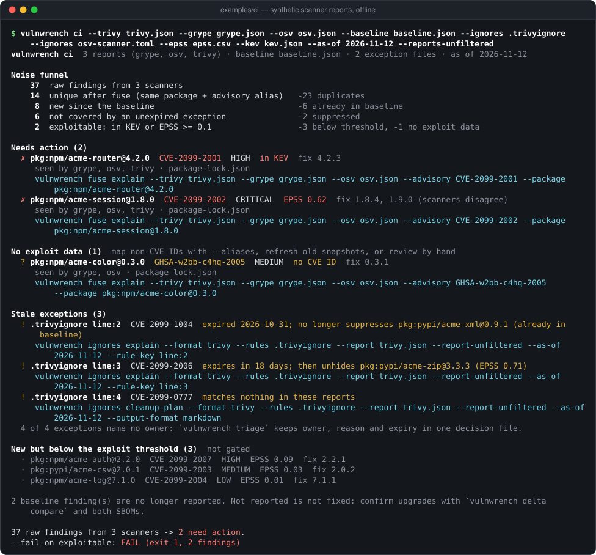

<p align="center">
  <picture>
    <source media="(prefers-color-scheme: dark)" srcset="assets/logo-dark.svg">
    
  </picture>
</p>

<p align="center">
  <strong>Turn three scanners' worth of CVE noise into the few findings that actually need a fix.</strong><br>
  One offline CLI to merge, diff, triage and gate Trivy, Grype, OSV-Scanner, SBOM and SARIF results in CI.
</p>

<p align="center">
  <a href="https://github.com/tianhaogutum/vulnwrench/actions/workflows/ci.yml"></a>
  <a href="https://pypi.org/project/vulnwrench/"></a>
  <a href="https://pypi.org/project/vulnwrench/"></a>
  <a href="LICENSE"></a>
</p>

<p align="center">
  English · <a href="README.zh-CN.md">简体中文</a>
</p>

<p align="center">
  <strong>37 raw findings from Trivy, Grype and OSV-Scanner → 2 that need action.</strong><br>
  <sub>Bundled synthetic repo: 23 cross-scanner duplicates, 6 already on <code>main</code>, 2 covered by an unexpired exception, 3 below the EPSS threshold, 1 without exploit data (listed for review). <a href="benchmarks/ci/results.json">Stored result</a> · <a href="docs/ci.md">method</a> · reproduce with <code>python3 scripts/ci/verify_examples.py</code>.</sub>
</p>

```sh
uvx vulnwrench ci --trivy trivy.json --grype grype.json --osv osv.json \
  --baseline main.fuse.json --ignores .trivyignore --epss epss.csv --kev kev.json   # or: pip install vulnwrench
```

<p align="center">
  
</p>
<p align="center"><sub>Real output on the bundled synthetic reports (<code>examples/ci</code>: fictional packages and advisory IDs, no network). Regenerate with <code>assets/render_terminal.py</code>.</sub></p>

## Quick start

`ci` reads the JSON reports your scanners already wrote. It never runs a scanner, writes a file or opens a network connection:

```sh
uvx vulnwrench ci --trivy trivy.json --grype grype.json --osv osv.json   # fuse + gate, every finding counts
uvx vulnwrench ci --trivy trivy.json --osv osv.json --baseline main.fuse.json \
  --ignores .trivyignore --ignores osv-scanner.toml \
  --epss epss.csv --kev known_exploited_vulnerabilities.json --format sarif > vulnwrench.sarif
```

Make the baseline on your default branch with `vulnwrench fuse merge --trivy trivy.json --osv osv.json --output main.fuse.json` and keep it as a CI artifact. Download the [EPSS](https://www.first.org/epss/data_stats) CSV and the [CISA KEV](https://www.cisa.gov/known-exploited-vulnerabilities-catalog) JSON in your own job step. To run the demo above from a clone:

```sh
git clone https://github.com/tianhaogutum/vulnwrench && cd vulnwrench/examples/ci
uvx vulnwrench ci --trivy trivy.json --grype grype.json --osv osv.json --baseline baseline.json \
  --ignores .trivyignore --ignores osv-scanner.toml --epss epss.csv --kev kev.json \
  --as-of 2026-11-12 --reports-unfiltered
```

Exit status: `0` gate passed, `1` findings at `--fail-on` (default `exploitable`; also `unknown`, `new`, `none`), `2` usage or input error. `--format json` prints a `vulnwrench.ci/v1` document; `--format sarif` prints SARIF 2.1.0 for code-scanning upload.

## What `ci` does

| Stage | Removes | Built on |
| --- | --- | --- |
| Fuse | The same vulnerability reported by several scanners or targets, joined by exact package identity and the scanners' own aliases (CVE ↔ GHSA ↔ OSV) | [`fuse`](docs/fuse.md) |
| Baseline | Findings already present in the base branch's saved merge; baseline findings that vanished are counted, not called fixed | [`fuse`](docs/fuse.md) |
| Exceptions | Findings named by an unexpired `.trivyignore` or `osv-scanner.toml` rule. Expired, soon-expiring, orphaned, duplicate and over-broad rules are reported | [`ignores`](docs/ignores.md) |
| Exploitability | Findings not in CISA KEV and below the EPSS threshold (default 0.1). Stale snapshots fail closed | [`exploit`](docs/exploit.md) |

Each stage calls the library behind the named command; `ci` adds no matching rules of its own. Every finding and stale exception in the report ends with the exact follow-up command, for example `vulnwrench fuse explain --trivy trivy.json --grype grype.json --osv osv.json --advisory CVE-2099-2001 --package pkg:npm/acme-router@4.2.0` (every observation, alias edge and severity/fix conflict behind it) or `vulnwrench ignores cleanup-plan ...` for an exception that matches nothing.

## All commands

| | Command | What it does | Docs |
| --- | --- | --- | --- |
| **Merge & compare** | `ci` | One CI gate: fuse, skip baseline and excepted findings, fail on exploitable ones | [ci](docs/ci.md) |
| | `fuse` | Merge Trivy, Grype and OSV-Scanner reports into one agreement/conflict matrix that keeps every observation | [fuse](docs/fuse.md) |
| | `delta` | Diff two Trivy/Grype scans against their CycloneDX inventories: really fixed, removed, renamed, still affected | [delta](docs/delta.md) |
| **SBOM & images** | `path` | Shortest CycloneDX/SPDX dependency path from each root to a Grype finding | [path](docs/path.md) |
| | `layers` | Attribute each Trivy image finding to the base image or the application layers by OCI DiffID | [layers](docs/layers.md) |
| | `scorecard` | Join CycloneDX components to saved OpenSSF Scorecard results and apply a policy | [scorecard](docs/scorecard.md) |
| **Exceptions & reviews** | `ignores` | Audit `.trivyignore` / `osv-scanner.toml` rules: orphans, expiry, owners, broad matches | [ignores](docs/ignores.md) |
| | `triage` | Keep exceptions in one typed decision file; compile it to `.trivyignore.yaml`, `osv-scanner.toml` and OpenVEX | [triage](docs/triage.md) |
| | `secrets` | Redacted, keyed review ledger of Gitleaks findings; classify each new report against it | [secrets](docs/secrets.md) |
| **CI gates** | `exploit` | Gate Trivy, Grype or OSV-Scanner findings on local EPSS and CISA KEV snapshots with an explained policy | [exploit](docs/exploit.md) |
| | `sarif` | Gate CI on SARIF 2.1.0 with accepted suppressions, rule defaults, baselines and scanner-failure checks | [sarif](docs/sarif.md) |

`vulnwrench <command> --help` lists every subcommand and option. Each command has synthetic, runnable examples in `examples/<command>/`; run them from the repository root.

## Quick start by group

### Merge & compare

```sh
vulnwrench fuse merge --trivy trivy.json --grype grype.json --osv osv.json --output merged.json --markdown merged.md
vulnwrench fuse explain --merged merged.json --finding f0001 --format markdown
vulnwrench delta compare --before before.json --after after.json \
  --before-bom before-bom.json --after-bom after-bom.json --metadata scans.json --fail-on introduced
```

### SBOM & images

```sh
vulnwrench path explain bom.json --grype grype.json --format markdown
vulnwrench layers explain --report trivy.json --base-config base.json --image-config image.json --gate app
vulnwrench scorecard check bom.json --map repos.json --scorecards scorecards/ --policy policy.json --gate
```

### Exceptions & reviews

```sh
vulnwrench ignores audit --format trivy --rules .trivyignore --report trivy.json --report-unfiltered
vulnwrench triage compile decisions.json --as-of 2026-11-11 --timestamp 2026-11-11T12:00:00Z \
  --author 'Security Team' --product-id urn:example:product:1.0 --out-dir vex/
vulnwrench secrets compare --key-file ledger.key --before before.json --report gitleaks.json --output comparison.json
```

### CI gates

```sh
vulnwrench exploit check --report trivy.json --epss epss.csv --kev kev.json --policy policy.json --as-of 2026-11-11
vulnwrench sarif check results.sarif --level error --require-execution-success
vulnwrench sarif check current.sarif --baseline before.sarif --fingerprint primary/v1
```

## Install

| Install | Gets you |
| --- | --- |
| `uvx vulnwrench <command>` | Run without installing |
| `pipx install vulnwrench` / `pip install vulnwrench` | The `vulnwrench` command with all eleven subcommands |

There are no extras and no runtime dependencies: every command uses the Python standard library only.

## How it compares

vulnwrench sits after your scanners. It does not find vulnerabilities, it decides what to do with the reports.

| You use | It does | vulnwrench adds |
| --- | --- | --- |
| Trivy, Grype, OSV-Scanner | Scan images, lockfiles and SBOMs | One deduplicated finding list across all three, with conflicts kept visible (`fuse`), and one gate over it (`ci`) |
| A scanner's own ignore file | Hides matching findings for that scanner | Expiry, orphan, owner and breadth audits (`ignores`), and one decision file compiled to every format (`triage`) |
| DefectDojo, Dependency-Track | Servers that import and track findings over time | No server, no database: a CLI step that reads files and exits 0 or 1. Use both if you want a dashboard |
| GitHub code scanning | Displays SARIF and diffs alerts per branch | A gate that runs before upload: accepted suppressions, baselines, failed-scan detection (`sarif`), and SARIF from `ci` |
| EPSS and KEV feeds | Exploit probability and confirmed exploitation | A dated, explained policy over your local snapshots (`exploit`), fail-closed when a snapshot is stale |
| Scorecard, Gitleaks | Repository health, leaked secrets | Policy joins against your SBOM (`scorecard`) and a redacted review ledger (`secrets`) |

## Trust and limits

- **Offline, no telemetry.** Every command reads local files only. No scanner runs, no target code executes, no network access.
- **Read-only unless you name an output.** `ci` writes nothing. Commands that write take an explicit path, replace files atomically and refuse to overwrite their inputs.
- **Evidence, not verdicts.** "Not reported" is never called "fixed" (use `delta` for that), scanner aliases are treated as assertions, EPSS is a probability and KEV is a list: none of them proves your code path is reachable.
- **The headline number is synthetic.** `examples/ci` uses fictional packages and advisory IDs to plant each kind of noise once. It shows what each stage removes, not what share of your findings it will remove.
- **Tested.** 1,500+ test functions; CI on Python 3.11 to 3.14 on Linux and macOS.
- **Platforms.** Linux and macOS, Python 3.11+. Windows is untested.

vulnwrench is independent and not affiliated with Aqua Security, Anchore, Google, the OpenSSF, FIRST, CISA, Gitleaks or GitHub. Third-party notices: [THIRD_PARTY.md](THIRD_PARTY.md).

## License

MIT. See [LICENSE](LICENSE).

---

<p align="center">If vulnwrench turned a wall of CVEs into a short to-do list, a star helps other people find it.</p>
