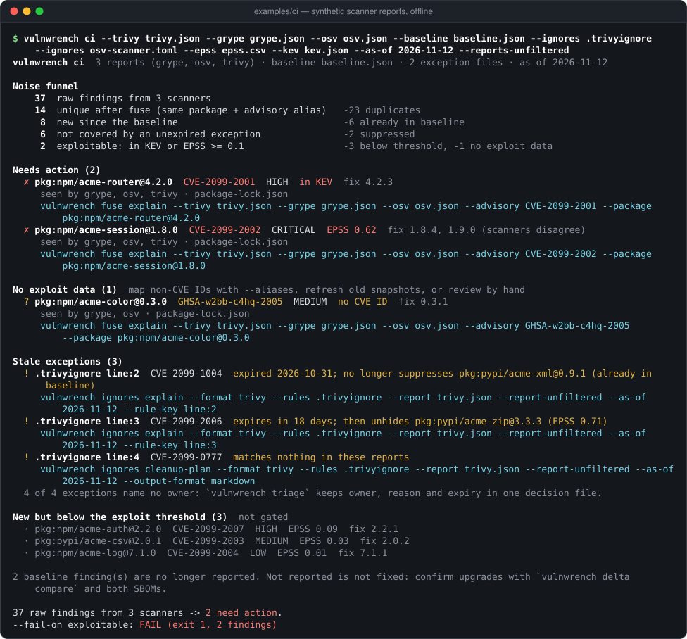

<p align="center">
  <picture>
    <source media="(prefers-color-scheme: dark)" srcset="assets/logo-dark.svg">
    
  </picture>
</p>

<p align="center">
  <strong>三个扫描器报出一大堆 CVE，真正要修的只有几个。vulnwrench 帮你把它们挑出来。</strong><br>
  一个离线 CLI，在 CI 里合并、对比、分诊和拦截 Trivy、Grype、OSV-Scanner、SBOM 与 SARIF 的结果。
</p>

<p align="center">
  <a href="https://github.com/tianhaogutum/vulnwrench/actions/workflows/ci.yml"></a>
  <a href="https://pypi.org/project/vulnwrench/"></a>
  <a href="https://pypi.org/project/vulnwrench/"></a>
  <a href="LICENSE"></a>
</p>

<p align="center">
  <a href="README.md">English</a> · 简体中文
</p>

<p align="center">
  <strong>Trivy、Grype、OSV-Scanner 一共报了 37 条，真正需要处理的是 2 条。</strong><br>
  <sub>仓库自带的合成示例：23 条是扫描器之间的重复，6 条在 <code>main</code> 上就已存在，2 条被未过期的例外规则覆盖，3 条 EPSS 低于阈值，1 条没有可用的利用数据（单独列出待人工看）。<a href="benchmarks/ci/results.json">存档结果</a> · <a href="docs/ci.md">方法</a> · 用 <code>python3 scripts/ci/verify_examples.py</code> 复现。</sub>
</p>

```sh
uvx vulnwrench ci --trivy trivy.json --grype grype.json --osv osv.json \
  --baseline main.fuse.json --ignores .trivyignore --epss epss.csv --kev kev.json   # 或：pip install vulnwrench
```

<p align="center">
  
</p>
<p align="center"><sub>仓库自带合成报告（<code>examples/ci</code>，包名和漏洞编号均为虚构，不联网）上的真实输出。用 <code>assets/render_terminal.py</code> 重新生成。</sub></p>

## 快速上手

`ci` 只读取扫描器已经写好的 JSON 报告。它不运行扫描器，不写文件，也不联网：

```sh
uvx vulnwrench ci --trivy trivy.json --grype grype.json --osv osv.json   # 合并去重后拦截，每条都算
uvx vulnwrench ci --trivy trivy.json --osv osv.json --baseline main.fuse.json \
  --ignores .trivyignore --ignores osv-scanner.toml \
  --epss epss.csv --kev known_exploited_vulnerabilities.json --format sarif > vulnwrench.sarif
```

基线在默认分支上生成：`vulnwrench fuse merge --trivy trivy.json --osv osv.json --output main.fuse.json`，然后存成 CI 产物。[EPSS](https://www.first.org/epss/data_stats) 的 CSV 和 [CISA KEV](https://www.cisa.gov/known-exploited-vulnerabilities-catalog) 的 JSON 请在你自己的 CI 步骤里下载。想先跑一下上面的演示：

```sh
git clone https://github.com/tianhaogutum/vulnwrench && cd vulnwrench/examples/ci
uvx vulnwrench ci --trivy trivy.json --grype grype.json --osv osv.json --baseline baseline.json \
  --ignores .trivyignore --ignores osv-scanner.toml --epss epss.csv --kev kev.json \
  --as-of 2026-11-12 --reports-unfiltered
```

退出码：`0` 关卡通过，`1` 有达到 `--fail-on` 级别的结果（默认 `exploitable`，还可选 `unknown`、`new`、`none`），`2` 用法或输入错误。`--format json` 输出 `vulnwrench.ci/v1` 文档，`--format sarif` 输出可上传到代码扫描的 SARIF 2.1.0。

## `ci` 做了什么

| 阶段 | 去掉什么 | 基于 |
| --- | --- | --- |
| 合并 | 多个扫描器或多个目标报出的同一个漏洞：按精确的包标识和扫描器自己声明的别名（CVE ↔ GHSA ↔ OSV）合并 | [`fuse`](docs/fuse.md) |
| 基线 | 基础分支保存的合并结果里已经有的；基线里有、现在消失的只计数，不当作“已修复” | [`fuse`](docs/fuse.md) |
| 例外 | 被未过期的 `.trivyignore` 或 `osv-scanner.toml` 规则点名的结果。同时报告已过期、即将过期、无匹配、重复和范围过宽的规则 | [`ignores`](docs/ignores.md) |
| 可利用性 | 不在 CISA KEV 里、EPSS 低于阈值（默认 0.1）的结果。快照过期时按失败处理 | [`exploit`](docs/exploit.md) |

每个阶段直接调用对应命令背后的库函数，`ci` 自己不另写匹配规则。报告里的每条结果和每条失效例外都附带下一步要跑的命令，例如 `vulnwrench fuse explain --trivy trivy.json --grype grype.json --osv osv.json --advisory CVE-2099-2001 --package pkg:npm/acme-router@4.2.0`（列出这条结果背后的每个观测、别名关系以及严重度和修复版本的冲突），或者对什么都没匹配到的例外给出 `vulnwrench ignores cleanup-plan ...`。

## 全部命令

| | 命令 | 作用 | 文档 |
| --- | --- | --- | --- |
| **合并与对比** | `ci` | 一个 CI 关卡：合并去重，跳过基线和例外，只拦可被利用的 | [ci](docs/ci.md) |
| | `fuse` | 把 Trivy、Grype、OSV-Scanner 的报告合并成一张一致/冲突矩阵，保留每一条原始观测 | [fuse](docs/fuse.md) |
| | `delta` | 结合 CycloneDX 清单对比两次 Trivy/Grype 扫描：真修复、包被移除、编号改名、升级后仍受影响 | [delta](docs/delta.md) |
| **SBOM 与镜像** | `path` | 从 CycloneDX/SPDX 的每个根到一条 Grype 结果的最短依赖路径 | [path](docs/path.md) |
| | `layers` | 按 OCI DiffID 判断每条 Trivy 镜像结果来自基础镜像还是应用层 | [layers](docs/layers.md) |
| | `scorecard` | 把 CycloneDX 组件关联到本地保存的 OpenSSF Scorecard 结果并套用策略 | [scorecard](docs/scorecard.md) |
| **例外与评审** | `ignores` | 审计 `.trivyignore` / `osv-scanner.toml`：无匹配、过期、无负责人、范围过宽 | [ignores](docs/ignores.md) |
| | `triage` | 用一份带类型的决策文件管理例外，编译成 `.trivyignore.yaml`、`osv-scanner.toml` 和 OpenVEX | [triage](docs/triage.md) |
| | `secrets` | Gitleaks 结果的脱敏、带密钥的评审台账，并对新报告逐条分类 | [secrets](docs/secrets.md) |
| **CI 关卡** | `exploit` | 依据本地 EPSS 和 CISA KEV 快照拦截 Trivy、Grype 或 OSV-Scanner 的结果，策略可解释 | [exploit](docs/exploit.md) |
| | `sarif` | 对 SARIF 2.1.0 设关卡，支持已接受的抑制、规则默认级别、基线和扫描失败检测 | [sarif](docs/sarif.md) |

`vulnwrench <命令> --help` 会列出所有子命令和选项。每个命令在 `examples/<命令>/` 下都有可运行的合成示例，请在仓库根目录运行。

## 按分组快速上手

### 合并与对比

```sh
vulnwrench fuse merge --trivy trivy.json --grype grype.json --osv osv.json --output merged.json --markdown merged.md
vulnwrench fuse explain --merged merged.json --finding f0001 --format markdown
vulnwrench delta compare --before before.json --after after.json \
  --before-bom before-bom.json --after-bom after-bom.json --metadata scans.json --fail-on introduced
```

### SBOM 与镜像

```sh
vulnwrench path explain bom.json --grype grype.json --format markdown
vulnwrench layers explain --report trivy.json --base-config base.json --image-config image.json --gate app
vulnwrench scorecard check bom.json --map repos.json --scorecards scorecards/ --policy policy.json --gate
```

### 例外与评审

```sh
vulnwrench ignores audit --format trivy --rules .trivyignore --report trivy.json --report-unfiltered
vulnwrench triage compile decisions.json --as-of 2026-11-11 --timestamp 2026-11-11T12:00:00Z \
  --author 'Security Team' --product-id urn:example:product:1.0 --out-dir vex/
vulnwrench secrets compare --key-file ledger.key --before before.json --report gitleaks.json --output comparison.json
```

### CI 关卡

```sh
vulnwrench exploit check --report trivy.json --epss epss.csv --kev kev.json --policy policy.json --as-of 2026-11-11
vulnwrench sarif check results.sarif --level error --require-execution-success
vulnwrench sarif check current.sarif --baseline before.sarif --fingerprint primary/v1
```

## 安装

| 安装方式 | 得到什么 |
| --- | --- |
| `uvx vulnwrench <命令>` | 不安装直接运行 |
| `pipx install vulnwrench` / `pip install vulnwrench` | `vulnwrench` 命令及全部 11 个子命令 |

没有可选依赖，也没有运行时依赖：所有命令只用 Python 标准库。

## 和现有工具的关系

vulnwrench 位于扫描器之后。它不负责发现漏洞，而是决定怎么处理扫描报告。

| 你在用 | 它负责 | vulnwrench 补上的 |
| --- | --- | --- |
| Trivy、Grype、OSV-Scanner | 扫描镜像、锁文件和 SBOM | 三者合并后的一份去重结果，冲突照样可见（`fuse`），再加一个统一关卡（`ci`） |
| 扫描器自带的忽略文件 | 对该扫描器隐藏匹配的结果 | 过期、无匹配、负责人和范围审计（`ignores`），以及一份决策文件编译成所有格式（`triage`） |
| DefectDojo、Dependency-Track | 导入并长期跟踪结果的服务端 | 不需要服务器和数据库：一个读文件、返回 0 或 1 的 CLI 步骤。想要看板可以两者并用 |
| GitHub 代码扫描 | 展示 SARIF，按分支对比告警 | 上传之前的关卡：已接受的抑制、基线、扫描失败检测（`sarif`），以及 `ci` 生成的 SARIF |
| EPSS 和 KEV 数据 | 被利用的概率和已确认的利用 | 基于本地快照、带日期且可解释的策略（`exploit`），快照过期就判失败 |
| Scorecard、Gitleaks | 仓库健康度、泄露的密钥 | 结合 SBOM 的策略关联（`scorecard`）和脱敏评审台账（`secrets`） |

## 可信度与局限

- **离线，无遥测。** 所有命令只读本地文件，不运行扫描器，不执行目标代码，不联网。
- **除非指定输出，否则只读。** `ci` 不写任何文件。会写文件的命令都要显式给出路径，原子替换，并拒绝覆盖输入文件。
- **给出证据，不下结论。** “没再报”绝不等于“已修复”（要证明修复请用 `delta`）；扫描器的别名只当作声明；EPSS 是概率，KEV 是清单，都不能证明你的代码路径可达。
- **首屏的数字来自合成数据。** `examples/ci` 用虚构的包名和漏洞编号，把每种噪声各放一次。它说明每个阶段能去掉什么，不代表在你的仓库上能去掉多大比例。
- **有测试。** 1,500 多个测试函数；CI 覆盖 Linux 和 macOS 上的 Python 3.11 到 3.14。
- **平台。** Linux 和 macOS，Python 3.11+。未在 Windows 上测试。

vulnwrench 是独立项目，与 Aqua Security、Anchore、Google、OpenSSF、FIRST、CISA、Gitleaks 和 GitHub 均无关联。第三方声明见 [THIRD_PARTY.md](THIRD_PARTY.md)。

## 许可证

MIT，见 [LICENSE](LICENSE)。

---

<p align="center">如果 vulnwrench 把一堵 CVE 墙变成了一张短短的待办清单，点个星能让更多人找到它。</p>
